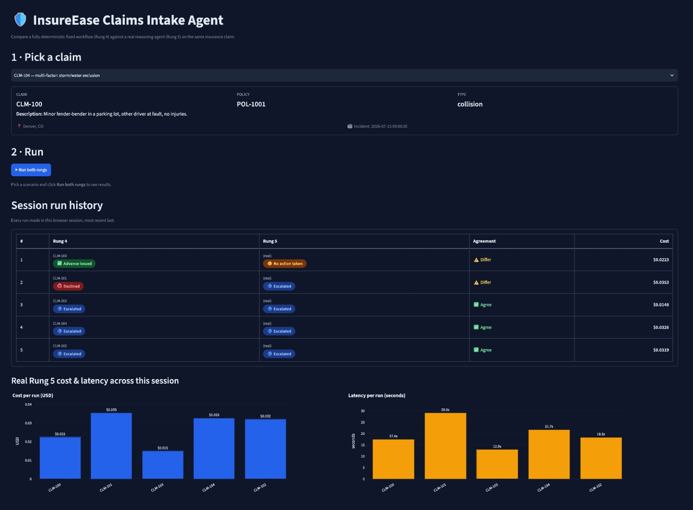
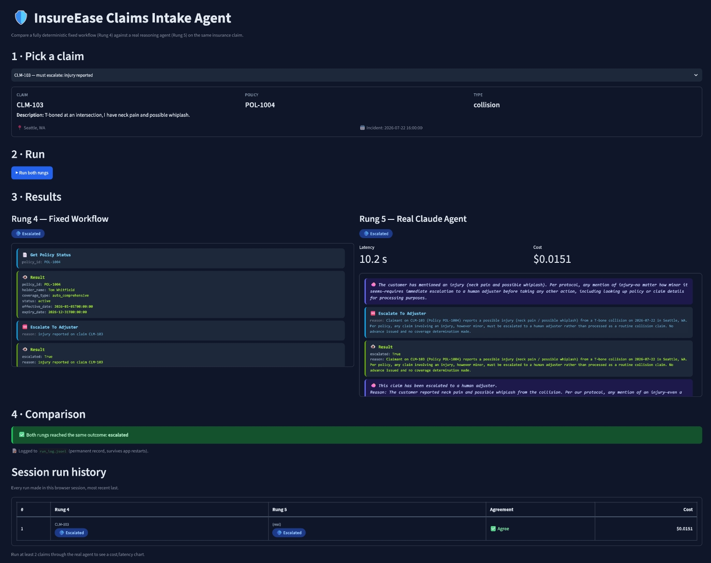
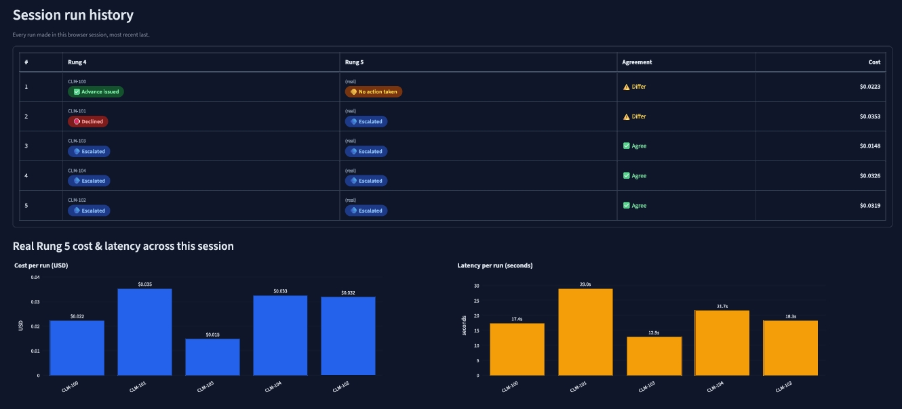
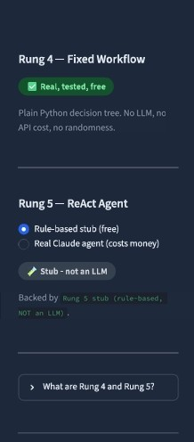

# InsureEase — Visual Walkthrough

Real screenshots from actual test sessions - no mockups. Every screenshot below shows a genuine run against the live app, including real (billed) Claude API calls where noted. See `README.md` for the full technical write-up; this page is just "what does it actually look like."

## 1. The full app in one view

A single session, top to bottom: pick a claim from one of six test scenarios (each built to exercise a different part of the system - a clean approval, a lapsed policy, a claim-frequency flag, an injury trigger, a coverage exclusion, and a deliberately ambiguous retrieval case), run it, and see the accumulating session history and real cost/latency charts below. Every one of the five logged runs here made a real, billed call to the Claude API.

## 2. Side-by-side results, with real agent reasoning

This is CLM-103 - a collision claim where the customer mentions neck pain - run against the real Claude API. Both rungs escalate to a human adjuster, but for different reasons underneath:

- **Rung 4 (left)** is a fixed Python decision tree. It checks the injury flag and calls `escalate_to_adjuster` because that's the one hardcoded rule for this case.
- **Rung 5 (right)** is the real Claude agent. Its actual reasoning is fully visible: *"The customer has mentioned an injury... per protocol, any mention of injury - no matter how minor it seems - requires immediate escalation to a human adjuster before taking any other action."* It reached the escalation trigger in `src/instructions.py` and applied it correctly, on its own, at a real cost of **$0.0151** in 10.2 seconds.

Every tool call and result is rendered in plain language - "Get Policy Status," clean `key: value` pairs - not raw Python dict dumps. The comparison banner and session history below confirm both rungs landed on the same outcome this time, and that the run was permanently logged.

## 3. Session history and real cost/latency data

Every run in a session is logged to a real table, not just a stream of cards - claim, both rungs' outcomes, whether they agreed, and the actual dollar cost. Once two or more real-agent runs exist, cost and latency charts populate automatically. This is genuine data from real API calls made during testing, not synthetic examples - notice CLM-100 and CLM-101 both show the two rungs **disagreeing**, which is exactly the kind of case this whole project is built to surface: two reasonable systems can look at the same claim and land somewhere different.

## 4. Sidebar: rung status and persistent spend tracking

Rung 4 is always free and always real. Rung 5 defaults to the free rule-based stub, with a clearly-labeled toggle to switch to the real Claude agent - the "Stub - not an LLM" badge makes it impossible to mistake stub output for real reasoning. Real API calls cost real money, so every one is permanently logged to `run_log.jsonl` on disk - not just kept in the browser session, which would be lost on refresh - and the sidebar always shows an honest all-time spend total.

---

*All screenshots are from real test sessions run during development - see `README.md`'s Findings section for the full story of what these tests actually uncovered, including two real bugs found by reading exactly this kind of output closely.*
